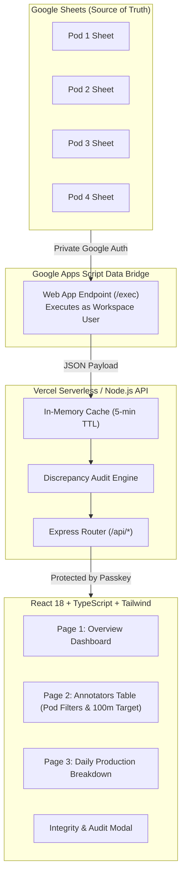

# AX Production — System Architecture & Production Guide

**AX Production** is an internal production monitoring platform designed for Team Leads, Reviewers, and Management to monitor daily annotation output, video minutes worked, and pod performance across four production pods in real time.

- **Live Web App**: [https://live-tracker-ochre.vercel.app/](https://live-tracker-ochre.vercel.app/)
- **GitHub Repository**: [https://github.com/AayushMali/Live-Tracker](https://github.com/AayushMali/Live-Tracker)
- **Default Team Passkey**: `ax2026`

---

## 1. Core Objectives

The platform provides immediate answers to four primary questions:
1. **Total Volume**: How many annotation tasks and video minutes were completed across all pods today?
2. **Pod Performance**: How much output (tasks and minutes) did each individual pod produce?
3. **Annotator Contribution**: How many tasks and minutes did each annotator log?
4. **Target Tracking**: Which annotators met or exceeded the daily target of **100 minutes**?

---

## 2. High-Level Architecture



---

## 3. Spreadsheet Data Structure & Mapping

The application connects to four distinct Google Spreadsheets via the `Daily output` tab:

| Pod | Spreadsheet ID |
|---|---|
| **Pod 1** | `1vjaFLjCEY-arc_-ubwsLQYgL-0CpbvZD1WKGGsLP1ko` |
| **Pod 2** | `1g4Z_kc_Kwx22-TYr2Jy9volaIWJy3KlOi-4MchPZrP8` |
| **Pod 3** | `1LiZ3dUqo-fQ0Yc5nSAxxazQWDd6IUaOYVIXYgQGXnB4` |
| **Pod 4** | `12kymnvHA8Pc_uBA0UbrGKjffyRZIKoro1zLqFtJhsUI` |

### Critical Column Structure

Each sheet is partitioned into distinct sections to prevent mixing duration metrics with task counts:

```
[ Col A ]  Annotator ID / Email
[ Col B ]  Annotator Full Name
[ Col C ]  Reviewer Name
...
[ Col K .. Col X ]   MINUTES OF VIDEO PER DAY ("30 Oct", "31 Oct", ..., "12 Nov")
[ Col Y ]            Divider ("Tasks logged per day →")
[ Col Z .. Col AM ]  TASKS LOGGED PER DAY ("30 Oct tasks", ..., "12 Nov tasks")
```

- **Row 1**: Date Headers (e.g. `12 Nov` for minutes, `12 Nov tasks` for tasks).
- **Row 2**: Pod Totals calculated by Google Sheet formulas.
- **Row 3+**: Individual Annotator rows.
- **Offset Relationship**: Column $Z$ (task index 25) corresponds directly to Column $K$ (minute index 10). The mathematical offset is consistently `minCol = taskCol - 15`.

### Annotator Daily Target
- **Daily Target**: **100 minutes** per active annotator.
- Annotators achieving $\ge 100$ minutes receive a visual **Target Met** indicator and progress tracking bar.

---

## 4. Application Pages & Features

### Page 1 — Overview (`/`)
- **Grand Total Metrics**: Total Tasks, Total Video Minutes, Active Pods ($X/4$), and Active Annotators.
- **Data Integrity Banner**: Real-time audit status verifying that calculated annotator sums match source sheet Row 2 totals.
- **Individual Pod Cards**: Displays pod-specific task counts, minute totals, active annotator headcount, and share percentage progress bar.
- **Date Selector**: Switch between any of the 14+ recorded dates with instant recalibration.

### Page 2 — Annotators (`/annotators`)
- **Pod Filters**: Instant tabbed switching between `All Pods`, `Pod 1`, `Pod 2`, `Pod 3`, and `Pod 4`.
- **Status Filters**: Quick toggles for `Completed Tasks`, `Zero Tasks` (members who have not logged activity yet), and `All Members`.
- **Production Table**:
  - `#` (Rank / Index)
  - Annotator Full Name (derived from Column B; never displays raw email addresses)
  - Pod Badge
  - Tasks Completed (lime green accent `#9DDB00`)
  - Minutes Worked (blue accent `#5689FF`)
  - Daily Target (100 min) with dynamic progress bar and `✓ Target Met` badge.
- **Live Search**: Client-side instant filter by name.

### Page 3 — Daily Production (`/daily-production`)
- **Hierarchical View**: `Date → Pod → Individual Annotator`.
- **Collapsible Pod Accordions**: Expand or collapse pods to inspect specific annotator contributions.
- **14-Day Timeline**: Chronological history table showing active pods, active annotators, and total production per date.

### Data Integrity & Audit Modal
- Click **"Audit Pod Totals"** in the header or overview banner.
- Inspects every pod side-by-side: Source Sheet Row 2 total vs. calculated sum of annotator rows, flagging discrepancies with exact delta values.

---

## 5. Security & Access Strategy

1. **Client Isolation**:
   - Google Drive/Sheets tokens and internal spreadsheet IDs are never exposed to the browser client.
   - All spreadsheet reads occur server-side via the Google Apps Script Web App executing under Google Workspace authorization.
2. **Access Passkey Gate**:
   - Default passkey: `ax2026`
   - Configurable via the `TEAM_PASSKEY` environment variable.
   - Session authenticated via secure HTTP bearer tokens stored in browser local storage.
3. **Read-Only Invariant**:
   - The application strictly operates in read-only mode and cannot mutate or delete source spreadsheet cells.

---

## 6. Live Google Apps Script Bridge Configuration

The Google Apps Script bridge connects private spreadsheets directly to the web dashboard without needing Google Cloud Service Account JSON keys.

### Script Location
The complete script is maintained in:
[`google-apps-script/Code.gs`](google-apps-script/Code.gs)

### Deployment Instructions
1. Open [script.google.com](https://script.google.com).
2. Select or create the project: **"AX Production API Bridge"**.
3. Replace `Code.gs` with the latest code from `google-apps-script/Code.gs`.
4. Click **Deploy** → **Manage deployments**.
5. Click the **Pencil (Edit)** icon on the active deployment.
6. Under **Version**, choose **New version**.
7. Ensure **Execute as** is set to **Me** and **Who has access** is set to **Anyone**.
8. Click **Deploy**.

The active Web App URL is:
```
https://script.google.com/macros/s/AKfycbyZ8kQ8cJ9Et_H4WQV_rZJ5SPQGIeGFrRiXKWgubtaTZsUMJpQuyfqEVQz-jy4qmviVUA/exec
```

---

## 7. API Reference

All endpoints return JSON and are hosted under `/api/*`:

| Endpoint | Method | Parameters | Description |
|---|---|---|---|
| `/api/production` | `GET` | `date=YYYY-MM-DD` | Overview summary, pod totals, and grand totals for a date. |
| `/api/annotators` | `GET` | `date=YYYY-MM-DD`, `pod=all\|1\|2\|3\|4` | Individual annotator list with tasks, minutes, and target status. |
| `/api/daily-production` | `GET` | `date=YYYY-MM-DD` | Hierarchical breakdown grouped by pod and annotator. |
| `/api/dates` | `GET` | None | List of all recorded dates with summary counts. |
| `/api/integrity` | `GET` | `date=YYYY-MM-DD` | Discrepancy audit report comparing Row 2 totals to annotator sums. |
| `/api/refresh` | `POST` | None | Clears server cache and triggers an immediate fetch from source sheets. |
| `/api/status` | `GET` | None | Health check, cache status, and current data source mode. |

---

## 8. Local Development & Deployment

### Prerequisites
- Node.js 18+
- npm 9+

### Commands

```bash
# Install dependencies
npm install

# Run TypeScript check & Vite build
npm run build

# Start local server (Express API + Vite Frontend)
npm start

# Run backend alone (port 3001)
node server/index.js
```

### Environment Variables

Create a `.env` file in the project root:

```env
PORT=3001
NODE_ENV=production
TEAM_PASSKEY=ax2026
APPS_SCRIPT_URL="https://script.google.com/macros/s/AKfycbyZ8kQ8cJ9Et_H4WQV_rZJ5SPQGIeGFrRiXKWgubtaTZsUMJpQuyfqEVQz-jy4qmviVUA/exec"
```

---

## 9. Automatic Updates & Adding New Dates

- **Automatic Polling**: The server automatically queries Google Sheets every 5 minutes in the background.
- **Manual Refresh**: Users can click the **Refresh** button in the header at any time.
- **Handling New Dates**: When new columns are added to the source sheets (e.g., `13 Nov` in Col Y and `13 Nov tasks` in Col AN), the parser automatically detects the new headers, registers the date, and updates the date selector without requiring any code modifications or redeployments.
